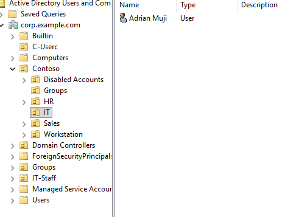
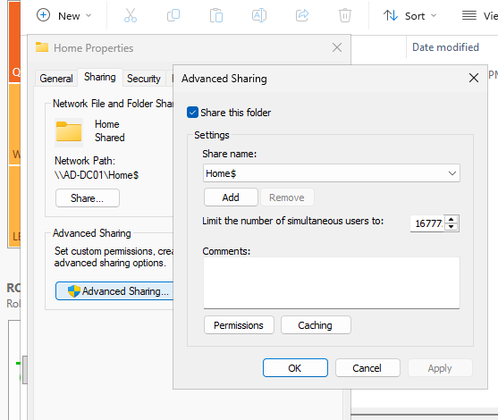
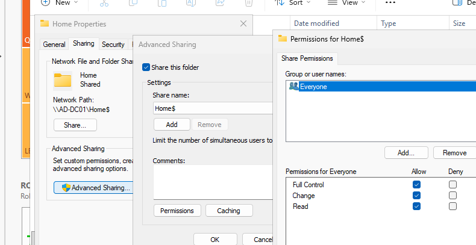
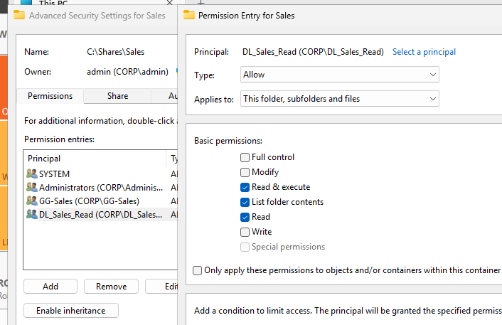

# Active Directory Helpdesk Lab

A hands-on home lab that simulates a real IT helpdesk. I built a small Active Directory environment for a fictional company (Contoso) and worked through eight realistic support tickets, solving each one to practice common helpdesk tasks.

## Lab Environment

| Component | Details |
| --- | --- |
| Domain | `corp.local` |
| Domain controller | `DC01` (Windows Server, Desktop Experience) |
| Client | `WIN-CLIENT` (Windows, domain-joined) |
| Tools used | Active Directory Users and Computers, Group Policy Management, Active Directory Administrative Center, File Explorer, RSAT |

### Directory Structure

```text
corp.local
└── Contoso
    ├── Sales
    ├── HR
    ├── IT
    ├── Groups
    ├── Workstations
    └── Disabled Accounts
```

Security groups: `GG_Sales`, `GG_HR`, and `GG_Helpdesk` are global groups; `DL_Sales_Read` is a domain-local group.

## Skills Demonstrated

- User account lifecycle: creation, unlock, password reset, and offboarding
- Group-based access control using AGDLP: Account, Global group, Domain Local group, and Permission
- Group Policy creation, linking, and troubleshooting
- Delegation of control using least privilege
- Fine-grained password policies
- Ticket documentation and verification

## Tickets

Each ticket was tested from the client as the affected user and documented with before-and-after screenshots.

## Ticket 1: Locked-Out User

**Problem:** A Sales user was locked out after multiple failed sign-in attempts.

**Solution:** Configured an account lockout policy, unlocked the account, and forced a password reset in Active Directory Users and Computers.

**Result:** The user signed in and was prompted to create a new password.

### Before




### After


## Ticket 2: New Hire Onboarding

**Problem:** HR requested a new user account, Sales access, and a home drive for a new employee.

**Solution:** Created the user by copying a Sales employee to inherit the appropriate group memberships, configured the job title and manager, and mapped an `H:` home drive to a hidden share.

**Result:** The new user signed in, was required to change the temporary password, and could access the `H:` drive.

### 1. Create the User Account

Created a user account for Peter Garcia in Active Directory Users and Computers by copying an existing Sales employee. This copied account inherited the Sales team memberships.


Next, signed in to the client as Peter Garcia. At this stage, the home folder was not available.


### 2. Create the Home Folder Share

Created the home folder directory at `C:\Share\Home` on the domain controller.

Opened the folder properties, selected **Sharing**, and enabled **Advanced Sharing**. Named the share `Home$` to create a hidden share.



Then opened **Permissions** and granted the appropriate access to the required users.

For this lab, the Everyone group was granted Full Control. In a production environment, permissions should normally be restricted to authorized users or groups.



### 3. Configure the User's Home Folder

Opened Peter Garcia's account properties, selected the **Profile** tab, and mapped a home folder to the hidden share:

`\\AD-DC01\Home$\%username%`

The `%username%` variable automatically creates or connects to a folder named for the signed-in user.


### 4. Verify the Home Drive

Signed in again as Peter Garcia and verified that the home folder was available as the `H:` drive.


## Ticket 3: Shared Folder Access

**Problem:** An HR user received an "Access is denied" error when attempting to open the Sales shared folder but needed read-only access.

**Solution:** Created the `DL_Sales_Read` domain-local group, added `GG_HR` to the group, and granted the domain-local group read and execute permissions on the Sales folder.

**Result:** The HR user could access the Sales shared folder with read-only permissions.

### Before

The HR user could not access the Sales shared folder.


### 1. Create the Domain-Local Group

Created `DL_Sales_Read` and added `GG_HR` as a member so that users in the HR group could access the Sales folder.


### 2. Grant Read and Execute Permissions

Added `DL_Sales_Read` to the Sales folder's security permissions and granted the group **Read & execute** permissions only.



### 3. Verify HR Access

Signed in as the HR user and verified that the Sales shared folder was accessible.


## Ticket 4: Automatically Map a Drive with Group Policy

**Problem:** Sales staff had to map the Sales shared folder manually.

**Solution:** Created and linked a Group Policy Object (GPO) to the Sales organizational unit (OU) using a Drive Maps preference that mapped `S:` to the Sales shared folder.

**Result:** Sales users received the `S:` drive when they signed in, while users outside the Sales OU did not receive it, confirming that the policy was correctly scoped.

### 1. Create and Link the GPO

Created a GPO under the Sales OU and linked it to the OU.


### 2. Configure the Mapped Drive

Opened **User Configuration**, then **Preferences**, **Windows Settings**, and **Drive Maps**. Right-clicked the empty area, selected **New**, and chose **Mapped Drive**.

Set the action to **Create**, entered `\\DC01\Sales` as the location, and selected `S:` as the drive letter. Enabled **Reconnect** so the drive would remap after each sign-in.


### 3. Verify the Mapped Drive

Signed in as a Sales department user and verified that the `S:` drive appeared in File Explorer.


## Ticket 5: Group Policy Not Applying

**Problem:** Lena, a Sales user, did not receive the `S:` drive, even though she was a member of `GG_Sales`.

**Solution:** Used the Group Policy Results Wizard to determine that the GPO was not applying because Lena's account was in the default Users container rather than the Sales OU. Moved her account to the Sales OU. After the drive was mapped, checked her group membership and the share permissions to resolve an initial access-denied issue.

**Result:** After refreshing the client's sign-in, Lena could access the mapped `S:` drive.

### 1. Identify Why the Drive Was Missing

Lena was a member of `GG_Sales`, but the `S:` drive was missing. Her account was in the default Users container rather than the Sales OU, so it was outside the scope of the GPO. Group Policy is linked to OUs, not security groups.


### 2. Move Lena to the Sales OU

Moved Lena's account to the Sales OU so that it would be in the scope of the drive-mapping GPO.


### 3. Verify the Drive and Resolve Access

After signing in again, Lena received the `S:` drive but initially could not open it. Checked that Lena was included in the group granted access to the Sales share and that the share permissions were configured correctly.


Restarted the client and signed in again to refresh the session. Lena could then open the `S:` drive and access its contents.


## Ticket 6: Delegate Password Resets

**Problem:** Helpdesk staff could not reset Sales users' passwords without assistance from a domain administrator.

**Solution:** Used the Delegate Control wizard on the Sales OU to grant `GG_Helpdesk` only the **Reset user passwords** and **Read all user information** permissions.

**Result:** Helpdesk password resets worked for users in Sales and were denied for users in HR, demonstrating least privilege.

### 1. Open the Delegation of Control Wizard

Right-clicked the Sales OU, selected **Delegate Control**, and added `GG_Helpdesk` to the wizard.


### 2. Select the Tasks to Delegate

Selected the task to reset user passwords, along with permission to read all user information.


### 3. Confirm the Delegated Permissions

Confirmed that `GG_Helpdesk` had permission to reset passwords for users in the Sales OU.


## Ticket 7: Stricter Passwords for IT Staff

**Problem:** A security audit required longer passwords for accounts that can reset others.

**Solution:** Created a Fine-Grained Password Policy (`PSO_Helpdesk`: 14 characters, 24 history, 60-day maximum age) in Active Directory Administrative Center and applied it to `GG_Helpdesk`.

**Result:** Short passwords were rejected for helpdesk users, and Resultant Password Settings confirmed that other users were unaffected.

## Ticket 8: Employee Offboarding

**Problem:** An employee left, and access had to be removed while keeping data for 30 days.

**Solution:** Disabled the account, reset the password, removed group memberships, recorded the ticket and deletion date in the description, and moved it to the `Disabled Accounts` OU.

**Result:** Sign-in was blocked with the "account has been disabled" message.

## What I Learned

- Group Policy links to OUs, not groups, so where an account lives determines what it receives.
- Granting access through groups instead of individuals keeps permissions manageable.
- Delegation is safer than adding helpdesk staff to Domain Admins.
- Disable first and delete later when offboarding.
- Always verify a fix as the affected user, and document it.
