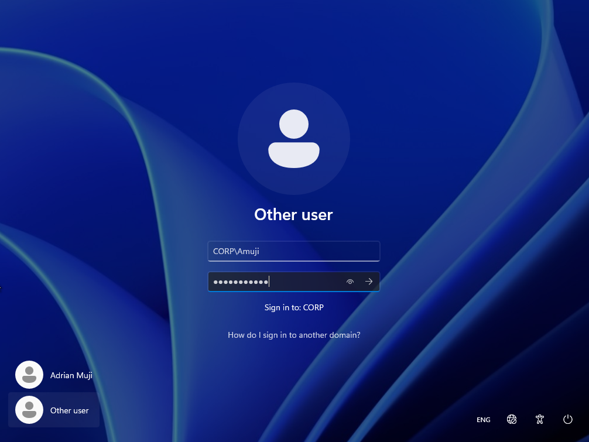

# Active Directory Helpdesk Lab
 
A hands-on home lab that simulates a real IT helpdesk. I built a small Active Directory environment for a fictional company (Contoso) and worked through eight realistic support tickets, solving each one using only the Windows Server graphical tools (no scripts).
 
## Lab Environment
 
| Component | Details |
| --- | --- |
| Domain | `corp.local` |
| Domain controller | `DC01` (Windows Server, Desktop Experience) |
| Client | `WIN-CLIENT` (Windows, domain-joined) |
| Tools used | Active Directory Users and Computers, Group Policy Management, Active Directory Administrative Center, File Explorer, RSAT |
 
### Directory structure
 
```
corp.local
└── Contoso
    ├── Sales
    ├── HR
    ├── IT
    ├── Groups
    ├── Workstations
    └── Disabled Accounts
```
 
Security groups: `GG_Sales`, `GG_HR`, `GG_Helpdesk` (global) and `DL_Sales_Read` (domain local).
 
## Skills Demonstrated
 
- User account lifecycle: creation, unlock, password reset, offboarding
- Group-based access control (AGDLP: Account, Global group, Domain Local group, Permission)
- Group Policy creation, linking and troubleshooting
- Delegation of control with least privilege
- Fine-grained password policies
- Ticket documentation and verification
## Tickets
 
Each ticket was tested from the client as the affected user, then documented with before and after screenshots.

## Ticket 1: Locked-Out User

**Problem:** A Sales user was locked out after failed sign-in attempts.
**Solution:** Configured an account lockout policy, then unlocked the account and forced a password reset in Active Directory Users and Computers.
**Result:** User signed in and was prompted to set a new password.

### Before




### After


### Ticket 2: New hire onboarding
 
**Problem:** HR requested an account, Sales access and a home drive for a new employee.
**Solution:** Created the user by copying a Sales teammate (inherits group membership), set job title and manager, and mapped an `H:` home folder to a hidden share.
**Result:** New user signed in, forced to change the temporary password, and saw the `H:` drive.
 
steps:
1. create user(Peter Garcia)
   (picture-ticket2 memeber-of)
   sign in using the account and see no sharing folder
   (pgarcia-before-sharing)
3. create shareing folder (C:\share\Home) then go to propert-share-advance sharing-clicked the share  and name it Home$ - go permission then clicked everyone and clicked full control
   (ticket2-share-home-permission-full-control)
4. clik peter garcia account then go to profile then connect Home folder to \\AD-DC01\Home$\%username%
(ticket2-connect)
5. sign in again to the account and see the shared file
   (pgarcia-after-sharing)
