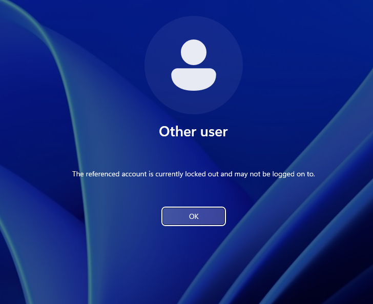
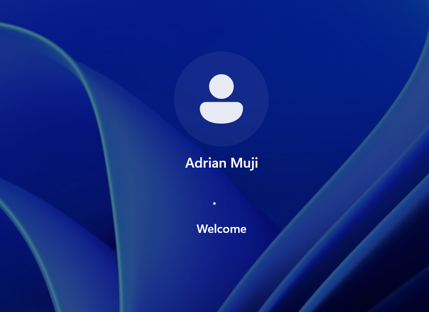

# Active_Directory

## Ticket 1: Locked-Out User

Ticket #1001, Priority: Adrian Muji (IT)  
"I typed my password wrong a few times and now it says my account is locked. I have a client call in 10 minutes."

### Before

### After

