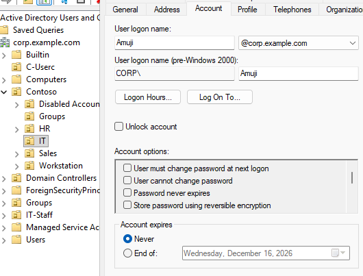
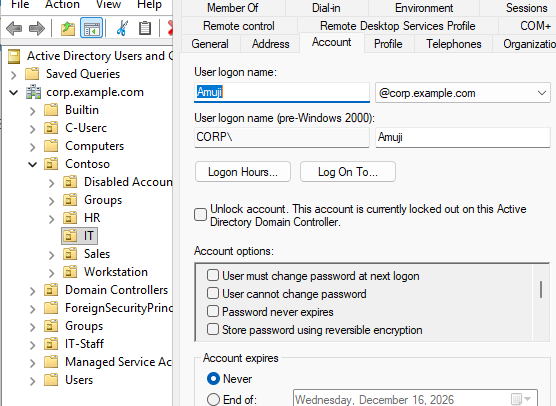
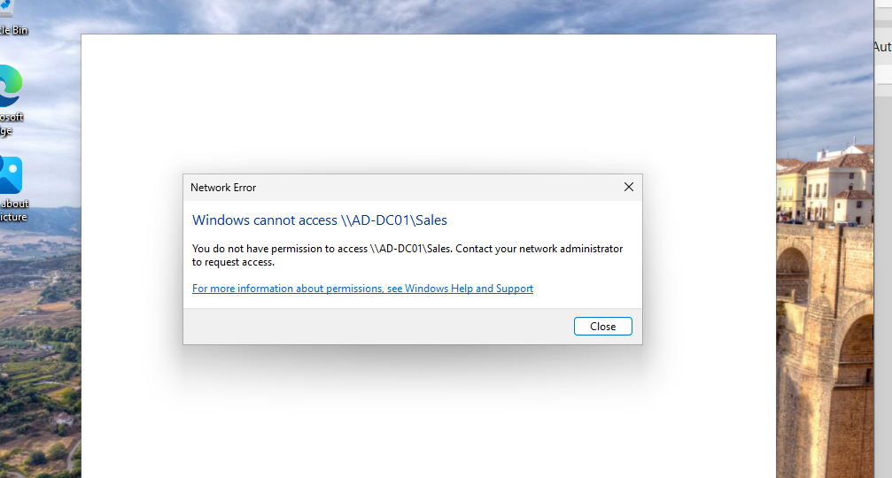
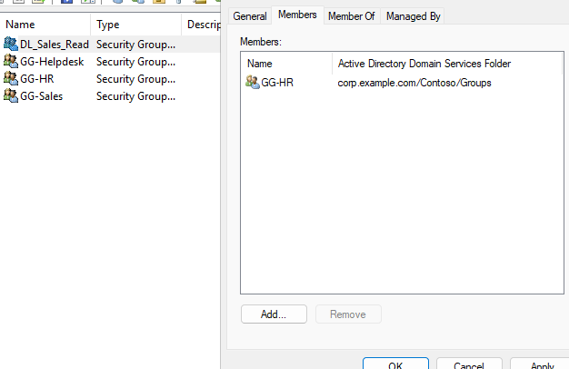
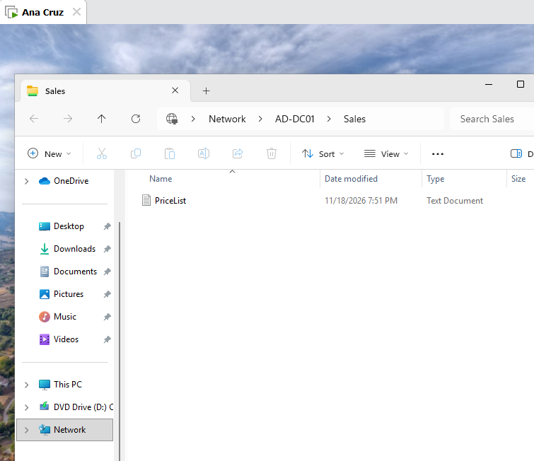

# Active Directory Helpdesk Lab

A hands-on home lab that simulates a real IT helpdesk. I built a small Active Directory environment for a fictional company (Contoso) and worked through eight realistic support tickets, solving each one to practice common helpdesk tasks.

## Lab Environment

| Component | Details |
| --- | --- |
| Domain | `corp.local` |
| Domain controller | `DC01` (Windows Server, Desktop Experience) |
| Client | `WIN-CLIENT` (Windows, domain-joined) |
| Tools used | Active Directory Users and Computers, Group Policy Management, Active Directory Administrative Center, File Explorer, RSAT |

### Directory Structure

```text
corp.local
└── Contoso
    ├── Sales
    ├── HR
    ├── IT
    ├── Groups
    ├── Workstations
    └── Disabled Accounts
```

Security groups: `GG_Sales`, `GG_HR`, and `GG_Helpdesk` are global groups; `DL_Sales_Read` is a domain-local group.

## Skills Demonstrated

- User account lifecycle: creation, unlock, password reset, and offboarding
- Group-based access control using AGDLP: Account, Global group, Domain Local group, and Permission
- Group Policy creation, linking, and troubleshooting
- Delegation of control using least privilege
- Fine-grained password policies
- Ticket documentation and verification

## Tickets

Each ticket was tested from the client as the affected user and documented with before-and-after screenshots.

## Ticket 1: Locked-Out User

**Problem:** A Sales user was locked out after multiple failed sign-in attempts.

**Solution:** Configured an account lockout policy, unlocked the account, and forced a password reset in Active Directory Users and Computers.

**Result:** The user signed in and was prompted to create a new password.

### Before





### After





## Ticket 2: New Hire Onboarding

**Problem:** HR requested a new user account, Sales access, and a home drive for a new employee.

**Solution:** Created the user by copying a Sales employee to inherit the appropriate group memberships, configured the job title and manager, and mapped an `H:` home drive to a hidden share.

**Result:** The new user signed in, was required to change the temporary password, and could access the `H:` drive.

### 1. Create the User Account

Created a user account for Peter Garcia in Active Directory Users and Computers by copying an existing Sales employee. This copied account inherited the Sales team memberships.


Next, signed in to the client as Peter Garcia. At this stage, the home folder was not available.


### 2. Create the Home Folder Share

Created the home folder directory at `C:\Share\Home` on the domain controller.

Opened the folder properties, selected **Sharing**, and enabled **Advanced Sharing**. Named the share `Home$` to create a hidden share.


Then opened **Permissions** and granted the appropriate access to the required users.

For this lab, the Everyone group was granted Full Control. In a production environment, permissions should normally be restricted to authorized users or groups.


### 3. Configure the User's Home Folder

Opened Peter Garcia's account properties, selected the **Profile** tab, and mapped a home folder to the hidden share:

`\\AD-DC01\Home$\%username%`

The `%username%` variable automatically creates or connects to a folder named for the signed-in user.


### 4. Verify the Home Drive

Signed in again as Peter Garcia and verified that the home folder was available as the `H:` drive.


## Ticket 3: Shared Folder Access

**Problem:** An HR user received an "Access is denied" error when attempting to open the Sales shared folder but needed read-only access.

**Solution:** Created the `DL_Sales_Read` domain-local group, added `GG_HR` to the group, and granted the domain-local group read and execute permissions on the Sales folder.

**Result:** The HR user could access the Sales shared folder with read-only permissions.

### Before

The HR user could not access the Sales shared folder.



### 1. Create the Domain-Local Group

Created `DL_Sales_Read` and added `GG_HR` as a member so that users in the HR group could access the Sales folder.



### 2. Grant Read and Execute Permissions

Added `DL_Sales_Read` to the Sales folder's security permissions and granted the group **Read & execute** permissions only.


### 3. Verify HR Access

Signed in as the HR user and verified that the Sales shared folder was accessible.



### Ticket 4: Auto-map a drive with Group Policy
 
**Problem:** Sales staff had to map the Sales folder manually.
**Solution:** Created and linked a GPO to the Sales OU using a Drive Maps preference that maps `S:` to the Sales share.
**Result:** Sales users received `S:` at sign-in; an IT user did not, confirming correct scoping.
