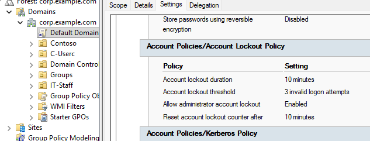
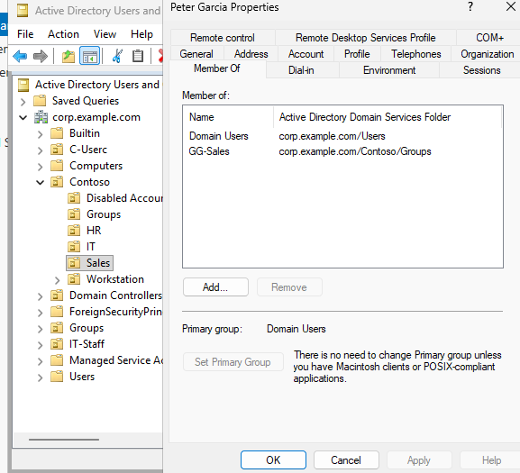
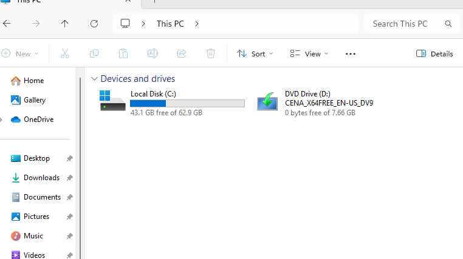
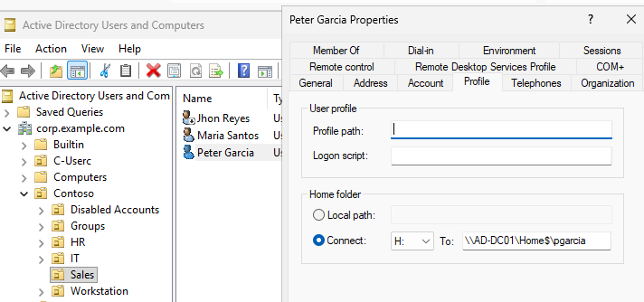
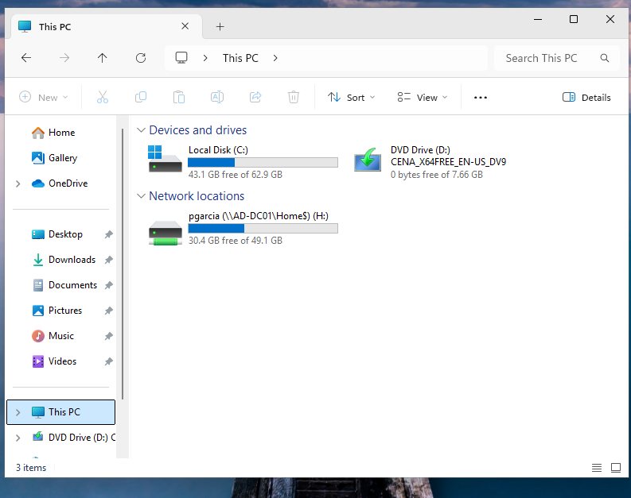

# Active Directory Helpdesk Lab

I wanted to learn Active Directory the way an IT support technician actually meets it: through tickets. So I built a small domain for a made-up company called Contoso, then worked through eight realistic helpdesk tickets, solving each one with the Windows Server graphical tools and testing every fix from a domain-joined client as the affected user.

## Quick Navigation

Click any link to jump straight to that section.

| # | Ticket | What I fixed |
| --- | --- | --- |
| 1 | [Locked-Out User](#ticket-1-locked-out-user) | Unlocked an account and reset its password |
| 2 | [New Hire Onboarding](#ticket-2-new-hire-onboarding) | Created a user with group access and a personal home drive |
| 3 | [Shared Folder Access](#ticket-3-shared-folder-access) | Gave HR read-only access to a Sales folder |
| 4 | [Automatically Map a Drive](#ticket-4-automatically-map-a-drive-with-group-policy) | Delivered a network drive to Sales with Group Policy |
| 5 | [Group Policy Not Applying](#ticket-5-group-policy-not-applying) | Found why one user never got the drive |
| 6 | [Delegate Password Resets](#ticket-6-delegate-password-resets) | Let the helpdesk reset passwords, and nothing more |
| 7 | [Stricter Passwords for IT Staff](#ticket-7-stricter-passwords-for-it-staff) | Enforced longer passwords for one group |
| 8 | [Employee Offboarding](#ticket-8-employee-offboarding) | Shut off a leaver's access safely |

Also on this page: [Lab Environment](#lab-environment) · [Skills Demonstrated](#skills-demonstrated) · [What I Learned](#what-i-learned)

---

## Lab Environment

| Component | Details |
| --- | --- |
| Domain | `corp.local` |
| Domain controller | `AD-DC01` (Windows Server, Desktop Experience) |
| Client | `WIN-CLIENT` (Windows, domain-joined) |
| Tools used | Active Directory Users and Computers, Group Policy Management, Active Directory Administrative Center, File Explorer, RSAT |

I organized Contoso into departments so every ticket had something realistic to act on:

```text
corp.local
└── Contoso
    ├── Sales
    ├── HR
    ├── IT
    ├── Groups
    ├── Workstations
    └── Disabled Accounts
```

For access control I created `GG_Sales`, `GG_HR` and `GG_Helpdesk` as global groups, plus `DL_Sales_Read` as a domain-local group.

[↑ Back to contents](#quick-navigation)

## Skills Demonstrated

- User account lifecycle: creation, unlock, password reset, and offboarding
- Group-based access control using AGDLP: Account, Global group, Domain Local group, and Permission
- Group Policy creation, linking, and troubleshooting
- Delegation of control using least privilege
- Fine-grained password policies
- Ticket documentation and verification

[↑ Back to contents](#quick-navigation)

---

## Ticket 1: Locked-Out User

**The ticket:** A Sales user was locked out after too many failed sign-in attempts.

I started by checking the account in Active Directory Users and Computers, which showed it healthy and not locked.


A fresh domain has no lockout rule, so I created one in the Account Lockout Policy first, which let me reproduce the problem the way a real user would hit it.




Then I went to the client and signed in with the wrong password until Windows turned me away.


Back on the server, the account now showed as locked.


I unlocked it and reset the password, forcing a change at the next sign-in. When the user tried again, Windows asked for a new password and let them in.


**Result:** The user was back at work and set a new password of their own.

[↑ Back to contents](#quick-navigation)

---

## Ticket 2: New Hire Onboarding

**The ticket:** HR asked for a new account for Peter Garcia, with Sales access and a home drive.

Rather than build the account from nothing, I copied an existing Sales employee in Active Directory Users and Computers. That way Peter inherited the Sales group memberships straight away, instead of me chasing each one down.



Before giving him a home folder, I signed in as Peter on the client to see his starting point. There was no home drive.



Next I set up the place the home folders would live. On the domain controller I created `C:\Share\Home`, opened its sharing settings and shared it as `Home$`. The `$` makes it a hidden share, so it doesn't show up when users browse the server.


For the share permissions I gave Everyone Full Control. That is fine for a lab, but in production I would restrict it to the people who need it.


The last piece was Peter's own account. On his Profile tab I pointed his home folder at:

`\\AD-DC01\Home$\%username%`

The `%username%` part is what makes this work for everyone. Windows replaces it with the logon name of whoever the account belongs to, so Peter gets `...\Home\pgarcia`, and the same path would give the next hire a folder of their own.



I signed in as Peter again and his `H:` drive was there, pointing at his private folder.



**Result:** Peter changed his temporary password at first sign-in and had his own `H:` drive from day one.

[↑ Back to contents](#quick-navigation)

---

## Ticket 3: Shared Folder Access

**The ticket:** A user in HR was getting "Access is denied" on the Sales folder, but they only needed to read what was in it.

I first confirmed the complaint by signing in as the HR user and trying to open the folder. It was denied, as reported.


I didn't want to give the HR user permission directly, because permissions tied to individuals become impossible to manage. Instead I followed the AGDLP approach. I created a domain-local group called `DL_Sales_Read` and made the HR global group, `GG_HR`, a member of it.


Then on the Sales folder's Security tab I added `DL_Sales_Read` and gave it **Read & execute** only, with no write access.


I signed in as the HR user again and the folder opened.


**Result:** HR could read the Sales files but could not change them, and no permission was given to any individual.

[↑ Back to contents](#quick-navigation)

---

## Ticket 4: Automatically Map a Drive with Group Policy

**The ticket:** Sales staff were mapping the Sales folder by hand, and wanted it to simply be there.

This was my first real Group Policy ticket. I created a GPO and linked it to the Sales OU, so it would apply only to people who live there.


Inside the GPO I went to User Configuration, Preferences, Windows Settings, then Drive Maps, and created a new mapped drive. I set the action to **Create**, pointed it at the Sales share, chose `S:` as the letter, and ticked **Reconnect** so it would come back at every sign-in.


Then I signed in as a Sales user and checked This PC. The `S:` drive was already there.


**Result:** Sales users got `S:` at sign-in, and users outside the Sales OU did not, which showed the policy was scoped correctly.

[↑ Back to contents](#quick-navigation)

---

## Ticket 5: Group Policy Not Applying

**The ticket:** Lena, a Sales user, did not get the `S:` drive, even though she was in `GG_Sales`.

This one taught me the most. Lena was in the right group, so on paper she should have had the drive. But Group Policy attaches to OUs, not to groups, so being in `GG_Sales` was never going to be enough. She had no drive.


I checked where her account actually lived. When I created her, I had added her to the default Users container instead of the Sales OU, so the GPO never reached her.


I moved her account into the Sales OU.


After she signed in again the drive appeared, but when she tried to open it she was refused. So the fix had exposed a second problem, and I had to work out whether it was a policy or a permission issue.


I checked her group membership and the share permissions. She was in the group that had access, and the share allowed it.


The missing piece was her session. Group membership is read when someone signs in, so her old session didn't know about it. I restarted the client and signed in again, and the drive opened.


**Result:** Lena had a working `S:` drive. Two lessons came out of it: where an account lives decides which policies it gets, and a change to someone's groups only takes effect after a fresh sign-in.

[↑ Back to contents](#quick-navigation)

---

## Ticket 6: Delegate Password Resets

**The ticket:** The helpdesk couldn't reset Sales users' passwords without asking a domain administrator.

The easy fix would have been to make helpdesk staff domain admins, but that would hand them far more power than the job needs. I wanted them to do one thing in one place.

I right-clicked the Sales OU, chose **Delegate Control**, and added the `GG_Helpdesk` group. I delegated to the group rather than to a person, so a future helpdesk hire only needs to be added to it.


From the list of tasks, I picked only the permission to reset user passwords, along with the permission to read user information.


Afterwards I checked the Sales OU's permissions and confirmed `GG_Helpdesk` had exactly that access.


**Result:** The helpdesk group holds just the permission to reset passwords in the Sales OU, nothing broader.

[↑ Back to contents](#quick-navigation)

---

## Ticket 7: Stricter Passwords for IT Staff

**The ticket:** A security audit pointed out that the accounts able to reset other people's passwords followed the same weak password rule as everyone else.

Changing the domain-wide policy would have affected every user, so I used a Fine-Grained Password Policy instead. In Active Directory Administrative Center I went to `corp.local`, then System, then Password Settings Container, and created `PSO_Helpdesk`: a 14-character minimum, 24 passwords remembered, and a 60-day maximum age. I applied it to `GG_Helpdesk` only, though the same approach can target any user or group.


To prove it worked, I tried to reset a test user's password to something eight characters long.


Windows rejected it because it didn't meet the 14-character requirement.


Then I tried again with 14 characters.


This time the reset went through.


**Result:** Helpdesk accounts now need longer passwords, while everyone else keeps the domain default.

[↑ Back to contents](#quick-navigation)

---

## Ticket 8: Employee Offboarding

**The ticket:** An employee had left. HR wanted their access shut off immediately, but their data kept for 30 days in case it was needed.

The rule I followed is to disable first and delete later. Deleting an account removes its identity for good, and that is hard to undo if someone asks for the files next week.

**1. Disable the account.** This is the step that blocks sign-in.


**2. Reset the password.** I set a long random one, so even someone who knew the old password could not use it.


**3. Remove the group memberships.** I opened the account and removed the user from their groups. That way, if the account were ever re-enabled by mistake, it would not bring the old access back.


**4. Leave a note.** In the account's description I wrote "Disabled 2026-11-15, Ticket 1008, delete after 2026-12-15", so anyone who found the account later would know why it was there and when to clean it up.


**5. Move it out of the way.** I moved the disabled account into the `Disabled Accounts` OU, which keeps leavers apart from active staff and makes the cleanup list easy to find.


**6. Test it.** Finally I tried to sign in as the departed user on the client. Windows refused and said the account had been disabled.


**Result:** The user could no longer sign in, and their data stayed in place for the 30-day window.

[↑ Back to contents](#quick-navigation)

---

## What I Learned

- Group Policy links to OUs, not groups, so where an account lives determines what it receives.
- Granting access through groups instead of individuals keeps permissions manageable.
- Changes to a user's groups only take effect after a fresh sign-in.
- Delegation is safer than adding helpdesk staff to Domain Admins.
- Disable first and delete later when offboarding.
- Always verify a fix as the affected user, and document it.

[↑ Back to contents](#quick-navigation)
